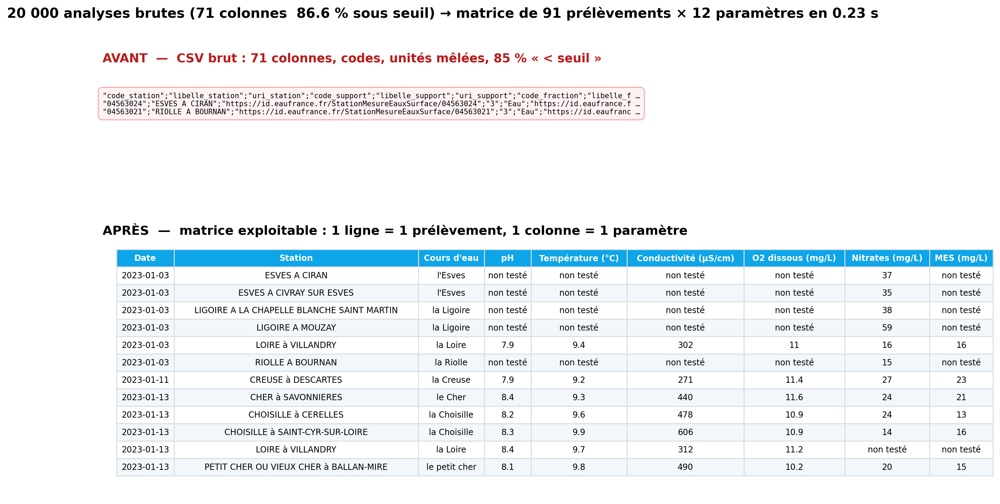
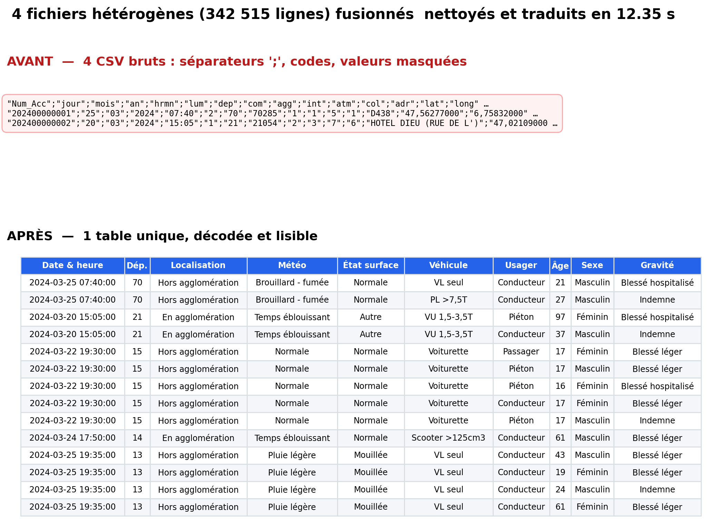

# Nikola Gandon

**Étudiant M2 Informatique (Intelligent Systems and Applications, Université de Tours) · AI engineering, RAG & data engineering**

Je construis des systèmes LLM et des pipelines de données où les garde-fous vivent dans le code, pas seulement dans le prompt.

🎯 Je cherche un **stage de fin d'études de 5 à 6 mois à partir de février 2027**.

Tours (mobilité France) · [LinkedIn](https://www.linkedin.com/in/nikola-gandon/)

---

## Projets récents · code privé

> Démos et schémas d'architecture sur demande via [LinkedIn](https://www.linkedin.com/in/nikola-gandon/).

### Bot de support Discord multilingue (RAG)
`TypeScript` `SvelteKit` `Prisma` · ~55 k lignes

- Recherche hybride vectorielle + lexicale (fusion RRF) sur PDF, pages web et salons Discord
- **Escalade vers un humain forcée dans le code** sous un seuil de confiance, pas seulement par le prompt

### Mêtis, orchestrateur multi-agents LLM
`Python` `LangGraph`

- Hypothèse → génération de code → exécution isolée → verdict d'un critique
- **Chaque citation est vérifiée mot pour mot** dans les sources (arXiv, PubMed), sinon elle est refusée

### Moteur de backtest et d'exécution sur séries temporelles
`Python` `SQLite` `pytest` · testnet uniquement, sans capital

- Séries à la minute sans biais de *look-ahead*, simulateur validé contre le vrai moteur : **0 écart sur 23 scénarios**
- **3 700 tests**, fuzzing sur 10 000 graines

### Stage R&D, machine learning scientifique (2026)
`PyTorch Geometric` · laboratoire de chimie, Université de Tours, en binôme

- Delta-ML : GNN équivariant qui corrige un calcul quantique rapide mais approximatif (xTB) vers la méthode de référence (DFT), sur **2,2 M de molécules**
- Données estimées à ~120 Go pour 32 Go de RAM, traitées par fragments

---

## Projets publics · pipelines de données

### Analyses de laboratoire : seuils de détection et mise en matrice
[ETL-Analyse-Labo](https://github.com/NikoGandon/ETL-Analyse-Labo) · données réelles [Hub'Eau](https://hubeau.eaufrance.fr/), analyses physico-chimiques, Indre-et-Loire (2023)

| Métrique | Détail |
|----------|--------|
| Entrée | 20 000 analyses · 71 colonnes · 86,6 % sous seuil de quantification |
| Sortie | 91 prélèvements × 12 paramètres · 2 livrables (calcul + rapport) |
| Traitement | 0,23 s |

- Distinction **« non testé »** / **« < LQ »** / valeur quantifiée
- Règle d'agrégation documentée en cas de doublons

### Consolidation multi-sources : accidents routiers
[ETL-accidents-routiers](https://github.com/NikoGandon/ETL-accidents-routiers) · données réelles [BAAC/ONISR](https://www.data.gouv.fr/datasets/bases-de-donnees-annuelles-des-accidents-corporels-de-la-circulation-routiere-annees-de-2005-a-2024), accidents corporels (2024)

| Métrique | Détail |
|----------|--------|
| Entrée | 4 fichiers (caractéristiques, lieux, véhicules, usagers) · 342 515 lignes cumulées · codes incompatibles |
| Sortie | 1 table au grain usager · 125 187 lignes (une par usager) · 30 variables décodées |
| Traitement | 12,35 s |

- Jointures contrôlées : clés uniques vérifiées, arrêt si le nombre de lignes change
- 15 846 doublons neutralisés, export CSV et Parquet

---

**Stack :** Python · PyTorch · LangGraph · TypeScript · SQL · Pandas · pytest · Docker · AWS (Terraform) · Git
